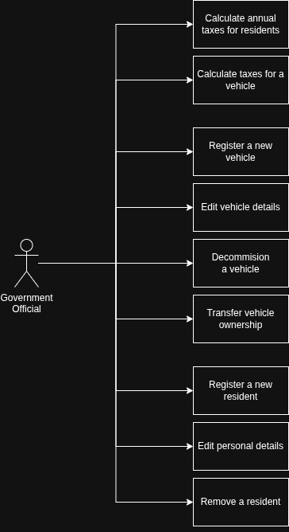
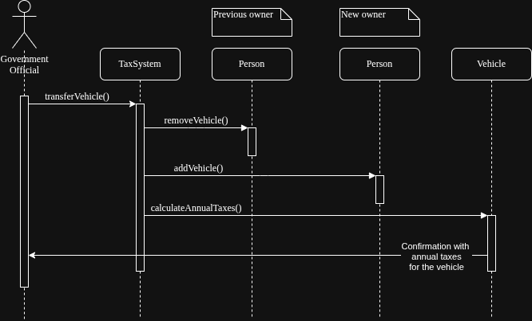
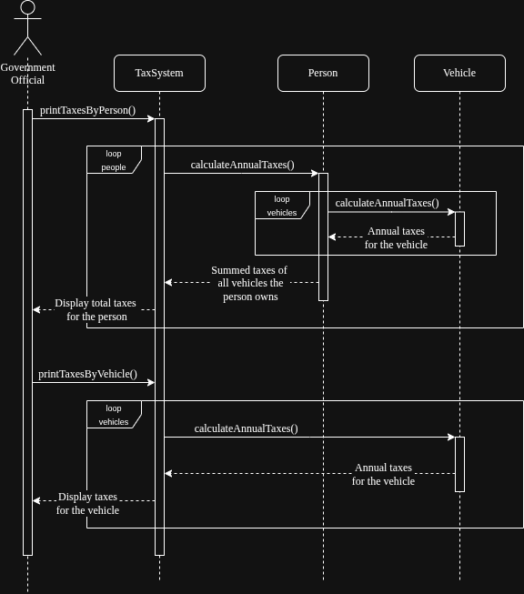
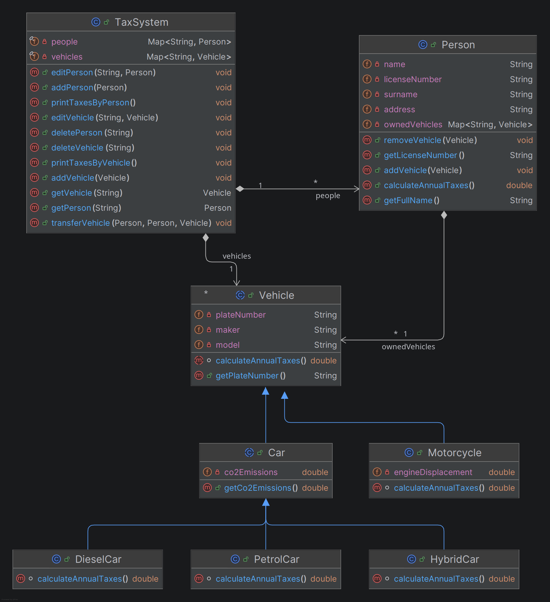

# System for managing people, vehicles and their taxes.

## Use case diagram

## Use case descriptions

### UC-01 Calculate annual taxes for residents

**ID:** UC-01

**Brief Description:**
Iterate over all registered residents and display the total annual taxes for each one.

**Primary Actor:** Government Official

**Secondary Actors:** None

**Pre-Conditions:**
1. None. If the system holds no residents, the iteration produces no output.

**Minimum Guarantees:**
1. For every registered resident, the total annual taxes are displayed. If there are no residents, nothing is printed.

**Success Guarantees:**
1. One line is printed for each resident in the form
   `Total annual taxes for <fullName> (<licenseNumber>) are <total>`.

**Primary Flow of Events:**
1. The Government Official initiates the use case.
2. The System iterates over every resident in its people map.
3. For each resident, the System sums `calculateAnnualTaxes()` over the vehicles in that
   resident's own `ownedVehicles` map.
4. The System prints `Total annual taxes for <fullName> (<licenseNumber>) are <total>`,
   where `<total>` is formatted with two decimals.
5. The use case ends.

**Alternative Flow of Events:**
2a: No Residents Registered
    1. The iteration runs zero times and no output is produced.
    2. The use case ends.
3a: Resident Owns No Vehicles
    1. The sum over an empty `ownedVehicles` map is 0.00.
    2. The use case resumes at step 4 (of Primary flow).

**Related Information:**
The taxes are derived from each resident's `ownedVehicles` map, not from the vehicles map
held by `TaxSystem`. A vehicle present in `TaxSystem` is only counted here if it was also
added to the resident through `Person.addVehicle(Vehicle)`.

**Priority:** High

### UC-02 Calculate taxes for a vehicle

**ID:** UC-02

**Brief Description:**
Iterates over all vehicles known to the system and print the annual taxes for each one.

**Primary Actor:** Government Official

**Secondary Actors:** None

**Pre-Conditions:**
1. None. If the system holds no vehicles, the iteration produces no output.

**Minimum Guarantees:**
1. For every vehicle currently held in the vehicles map, one line is printed. If there are
   no vehicles, nothing is printed.

**Success Guarantees:**
1. One line is printed for each vehicle in the form
   `Annual taxes for the vehicle <plateNumber> are <tax>`.

**Primary Flow of Events:**
1. The Government Official initiates the use case.
2. The System iterates over every vehicle in its vehicles map.
3. For each vehicle, the System calls `calculateAnnualTaxes()`, which returns:
    - Petrol car: 1.4 x CO2 emissions
    - Diesel car: 1.8 x CO2 emissions
    - Hybrid car: 1.2 x CO2 emissions
    - Motorcycle: 0.1 x engine displacement
4. The System prints `Annual taxes for the vehicle <plateNumber> are <tax>`, where `<tax>`
   is formatted with two decimals.
5. The use case ends.

**Alternative Flow of Events:**
2a: No Vehicles Registered
    1. The iteration runs zero times and no output is produced.
    2. The use case ends.

**Priority:** High

### UC-03 Register a new vehicle

**ID:** UC-03

**Brief Description:**
This use case stores a vehicle in the system, keyed by its plate number.

**Primary Actor:** Government Official

**Secondary Actors:** None

**Pre-Conditions:**
1. A `Vehicle` object with its plate number, maker, model and type-specific data already
   exists and is supplied to the system.

**Minimum Guarantees:**
1. The vehicles map contains an entry for the supplied plate number.

**Success Guarantees:**
1. The supplied vehicle is stored in the vehicles map under `vehicle.getPlateNumber()`.

**Primary Flow of Events:**
1. The Government Official supplies a vehicle to the system.
2. The System executes `vehicles.put(vehicle.getPlateNumber(), vehicle)`.
3. The use case ends.

**Alternative Flow of Events:**
2a: Plate Number Already Registered
    1. The existing entry is silently overwritten. No error is raised and no confirmation
       is produced.
    2. The use case ends.

**Related Information:**
No validation is performed and no owner is associated. This use case does not add the
vehicle to any resident's `ownedVehicles` map.

**Priority:** High

### UC-04 Edit vehicle details

**ID:** UC-04

**Brief Description:**
This use case replaces the vehicle stored under a given plate number with a modified vehicle.

**Primary Actor:** Government Official

**Secondary Actors:** None

**Pre-Conditions:**
1. The plate number exists in the vehicles map.

**Minimum Guarantees:**
1. Either the entry has been replaced or an `IllegalArgumentException` has been thrown.

**Success Guarantees:**
1. The vehicles map holds the modified vehicle under the unchanged plate number.

**Primary Flow of Events:**
1. The Government Official supplies the plate number and a modified `Vehicle`.
2. The System checks, ignoring case, that the supplied plate number equals
   `modifiedVehicle.getPlateNumber()`.
3. The System checks that the vehicles map contains the supplied plate number.
4. The System executes `vehicles.put(plateNumber, modifiedVehicle)`.
5. The use case ends.

**Alternative Flow of Events:**
2a: Plate Number Modified
    1. The System throws `IllegalArgumentException("Vehicle plate number cannot be
       modified")`.
    2. The use case ends.
3a: Vehicle Does Not Exist
    1. The System throws `IllegalArgumentException("The vehicle does not exist")`.
    2. The use case ends.

**Related Information:**
No validation of the modified vehicle's other details is performed and no confirmation is produced.

**Priority:** Medium

### UC-05 Decommission a vehicle

**ID:** UC-05

**Brief Description:**
This use case removes a vehicle from the system by its plate number.

**Primary Actor:** Government Official

**Secondary Actors:** None

**Pre-Conditions:**
1. None. Removing an unknown plate number is allowed.

**Minimum Guarantees:**
1. The vehicles map no longer contains an entry for the supplied plate number.

**Success Guarantees:**
1. The vehicles map no longer contains an entry for the supplied plate number.

**Primary Flow of Events:**
1. The Government Official supplies the plate number.
2. The System executes `vehicles.remove(plateNumber)`.
3. The use case ends.

**Alternative Flow of Events:**
2a: Plate Number Not Registered
    1. The removal returns without effect and no error is raised.
    2. The use case ends.

**Related Information:**
The vehicle is not removed from any resident's `ownedVehicles` map, so it may still be
counted by UC-01.

**Priority:** Medium

### UC-06 Transfer vehicle ownership

**ID:** UC-06

**Brief Description:**
This use case transfers a vehicle from its previous owner to a new owner and prints the result.

**Primary Actor:** Government Official

**Secondary Actors:** None

**Pre-Conditions:**
1. The previous owner owns the vehicle.
2. The previous owner, the new owner and the vehicle are non-null.

**Minimum Guarantees:**
1. Either the vehicle has been moved to the new owner, or an
   `IllegalArgumentException` has been thrown and the new owner is unchanged.

**Success Guarantees:**
1. The vehicle is present in the new owner's `ownedVehicles` map and absent from the
   previous owner's `ownedVehicles` map, and a confirmation line has been printed.

**Primary Flow of Events:**
1. The Government Official supplies the previous owner, the new owner and the vehicle.
2. The System calls `previousOwner.removeVehicle(vehicle)`.
3. The System calls `newOwner.addVehicle(vehicle)`.
4. The System prints
   `Vehicle <plateNumber> tranferred from <previousLicense> to <newLicense>. Annual taxes:
   <tax>`, where `<tax>` is the vehicle's `calculateAnnualTaxes()` with two decimals. (The
   spelling "tranferred" matches the code.)
5. The use case ends.

**Alternative Flow of Events:**
2a: Previous Owner Does Not Own the Vehicle
    1. `removeVehicle` throws
       `IllegalArgumentException("The person does not own the specified vehicle")`.
    2. `newOwner.addVehicle` is not executed and the new owner is unchanged.
    3. The use case ends.

**Related Information:**
No check is made that the new owner differs from the previous owner. The vehicles map held
by `TaxSystem` is not modified by this use case.

**Priority:** High

### UC-07 Register a new resident

**ID:** UC-07

**Brief Description:**
This use case stores a resident in the system, keyed by their license number.

**Primary Actor:** Government Official

**Secondary Actors:** None

**Pre-Conditions:**
1. A `Person` object with a license number, name, surname and address already exists and is
   supplied to the system.

**Minimum Guarantees:**
1. The people map contains an entry for the supplied license number.

**Success Guarantees:**
1. The supplied person is stored in the people map under `person.getLicenseNumber()`.

**Primary Flow of Events:**
1. The Government Official supplies a person to the system.
2. The System executes `people.put(person.getLicenseNumber(), person)`.
3. The use case ends.

**Alternative Flow of Events:**
2a: License Number Already Registered
    1. The existing entry is silently overwritten. No error is raised and no confirmation
       is produced.
    2. The use case ends.

**Related Information:**
No validation is performed and no vehicles are associated with the new resident.

**Priority:** High

### UC-08 Edit personal details

**ID:** UC-08

**Brief Description:**
This use case replaces the resident stored under a given license number with a modified person.

**Primary Actor:** Government Official

**Secondary Actors:** None

**Pre-Conditions:**
1. The license number exists in the people map.

**Minimum Guarantees:**
1. Either the entry has been replaced or an `IllegalArgumentException` has been thrown.

**Success Guarantees:**
1. The people map holds the modified person under the unchanged license number.

**Primary Flow of Events:**
1. The Government Official supplies the license number and a modified `Person`.
2. The System checks, ignoring case, that the supplied license number equals
   `modifiedPerson.getLicenseNumber()`.
3. The System checks that the people map contains the supplied license number.
4. The System executes `people.put(licenseNumber, modifiedPerson)`.
5. The use case ends.

**Alternative Flow of Events:**
2a: License Number Modified
    1. The System throws `IllegalArgumentException("Person license number cannot be
       modified")`.
    2. The use case ends.
3a: Person Does Not Exist
    1. The System throws `IllegalArgumentException("The person does not exist")`.
    2. The use case ends.

**Related Information:**
No validation of the modified person's other details is performed and no confirmation is produced.

**Priority:** Medium

### UC-09 Remove a resident

**ID:** UC-09

**Brief Description:**
This use case removes a resident from the system by their license number.

**Primary Actor:** Government Official

**Secondary Actors:** None

**Pre-Conditions:**
1. None. Removing an unknown license number is allowed.

**Minimum Guarantees:**
1. The people map no longer contains an entry for the supplied license number.

**Success Guarantees:**
1. The people map no longer contains an entry for the supplied license number.

**Primary Flow of Events:**
1. The Government Official supplies the license number.
2. The System executes `people.remove(licenseNumber)`.
3. The use case ends.

**Alternative Flow of Events:**
2a: License Number Not Registered
    1. The removal returns without effect and no error is raised.
    2. The use case ends.

**Related Information:**
The resident's owned vehicles and the vehicles map held by `TaxSystem` are not changed.

**Priority:** Medium

## Sequence diagrams

### Transferring a vehicle

### Listing taxes

## Class diagram

